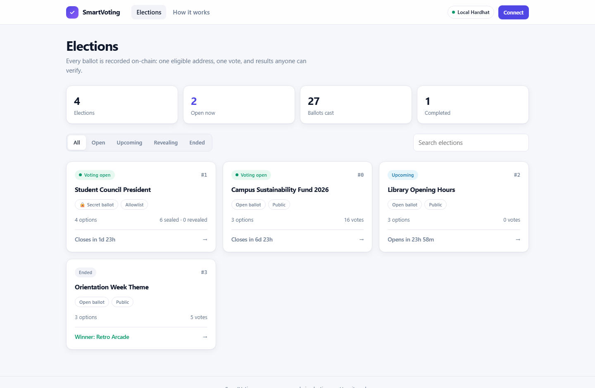
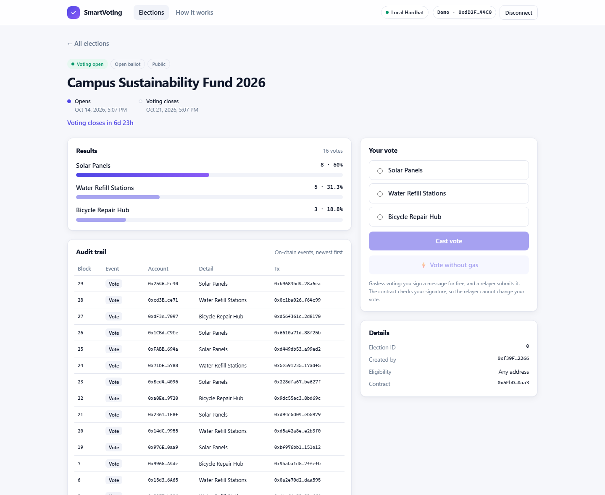
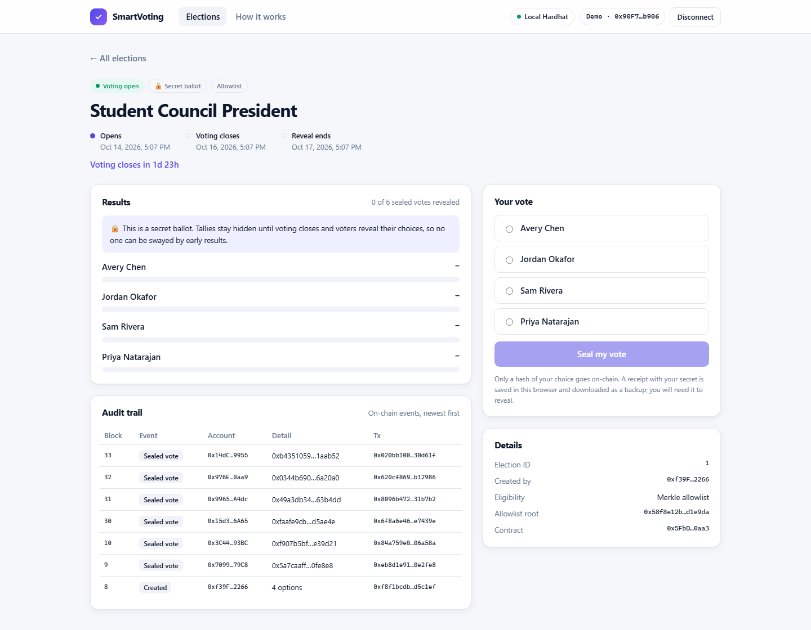
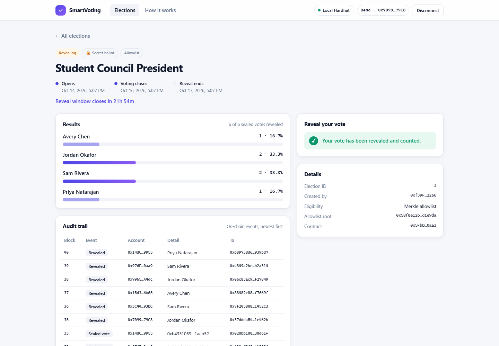
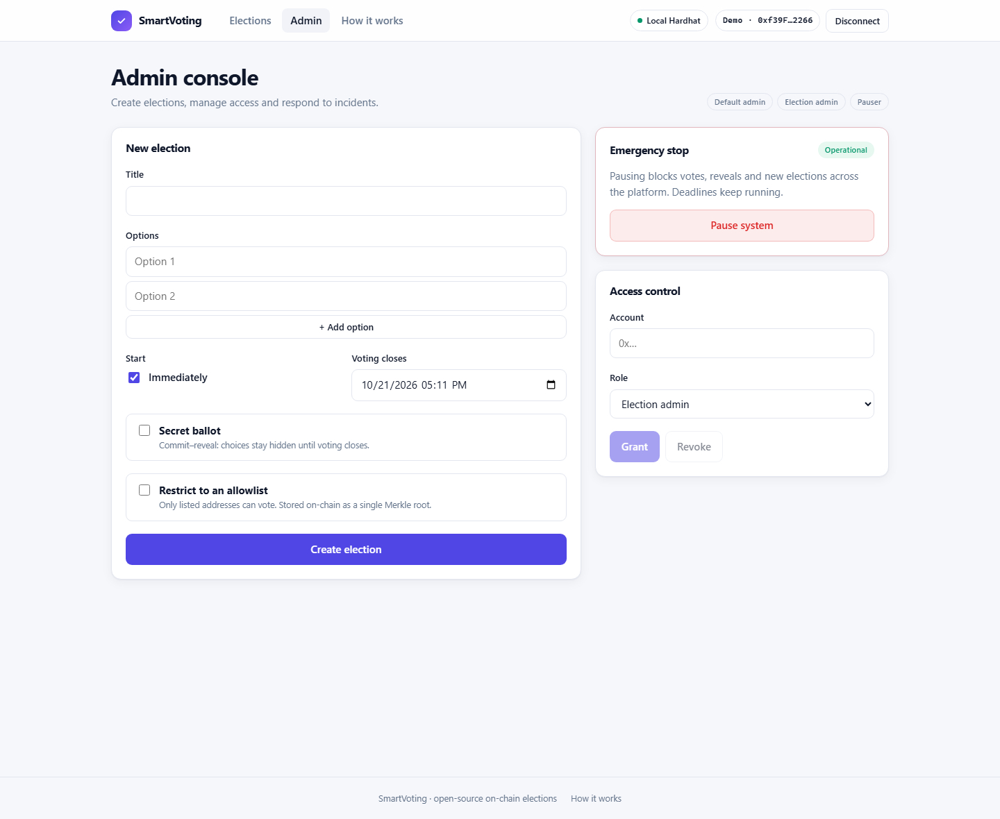
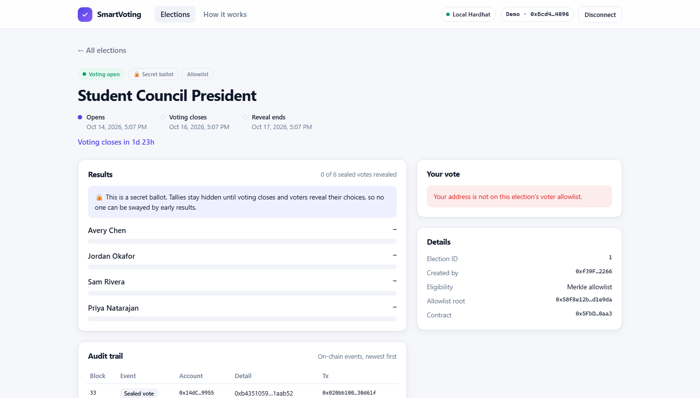
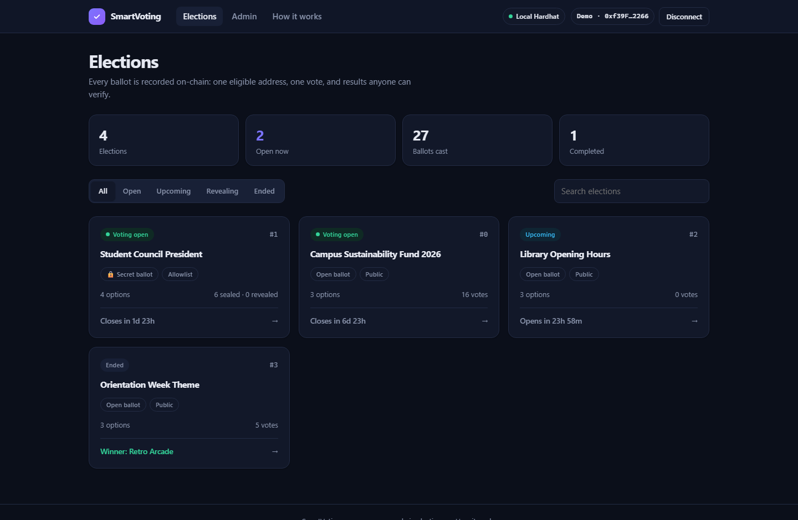
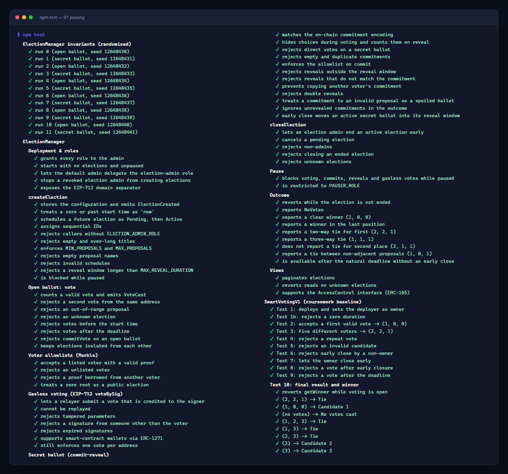
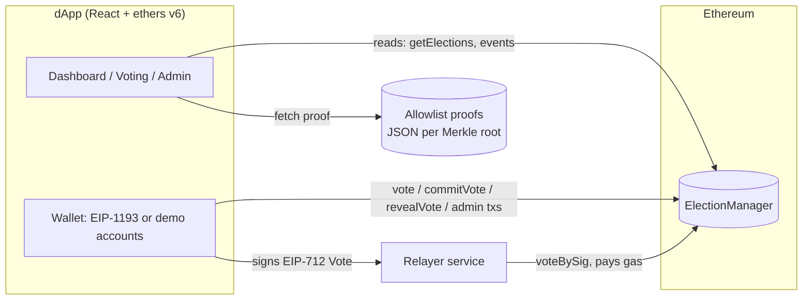
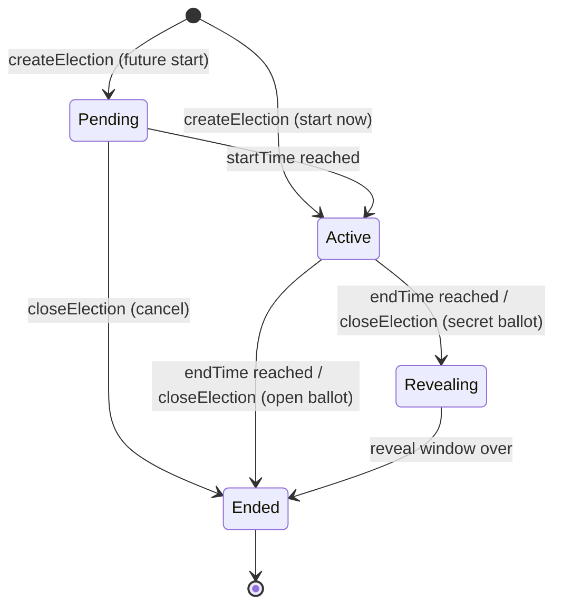

<div align="center">

# 🗳️ SmartVoting

**Secure, verifiable elections on Ethereum: secret ballots, gasless voting and voter allowlists, with a production-style dApp.**

### [▶ Try the live demo](https://amirhamzaaaa4.github.io/smart-voting-dapp/)

No wallet, no crypto, no sign-up: the real smart contract runs on an Ethereum VM inside your browser.

[](https://amirhamzaaaa4.github.io/smart-voting-dapp/)

[](https://github.com/amirhamzaaaa4/smart-voting-dapp/actions/workflows/ci.yml)


[Live demo](https://amirhamzaaaa4.github.io/smart-voting-dapp/) · [Features](#-features) · [Quick start](#-quick-start) · [Architecture](#-architecture) · [Security](#-security-design) · [Testing](#-testing) · [Deploying](#-deploying-to-a-testnet)

</div>

---

SmartVoting started as a university assignment: a single, three-option ballot contract tested by hand in Remix. This repository is a complete re-engineering of that idea into a **multi-election voting platform** with the features real on-chain governance systems rely on:

|                        | Coursework v1          | **SmartVoting v2**                                            |
| ---------------------- | ---------------------- | ------------------------------------------------------------- |
| Elections per contract | 1                      | Unlimited, isolated                                           |
| Options                | Hard-coded 3           | 2–20, named                                                   |
| Eligibility            | Any address            | Public **or** Merkle-root allowlist (any size)                |
| Ballot privacy         | Tallies always visible | Optional **commit–reveal secret ballot**                      |
| Who pays gas           | Voter                  | Voter **or a relayer** (EIP-712 / ERC-1271 signatures)        |
| Administration         | Single owner           | **Role-based** (admin / election admin / pauser)              |
| Incident response      | None                   | **Emergency pause**                                           |
| Scheduling             | Starts at deploy       | Future start times, early close, cancellation                 |
| Errors                 | Revert strings         | Typed custom errors (cheaper and machine-readable)            |
| Testing                | 10 manual Remix checks | **97 automated tests, 100 % coverage, randomized invariants** |
| Interface              | Remix                  | **React + TypeScript dApp**, admin console, audit trail       |

The original contract is kept unchanged in [`contracts/legacy/`](contracts/legacy/SmartVotingV1.sol), and the 10 manual tests from the report are reproduced as automated tests in [`test/SmartVotingV1.test.js`](test/SmartVotingV1.test.js).



## 📸 Screenshots

| Voting with live results and audit trail                    | Secret ballot: choices hidden until the reveal           |
| ----------------------------------------------------------- | -------------------------------------------------------- |
|   |   |
| **Secret ballot after the reveal**                          | **Final results**                                        |
|  |   |
| **Admin console**                                           | **Allowlist enforcement**                                |
|      |  |
| **Dark mode**                                               | **97 tests passing · 100% coverage**                     |
|              |           |

More pictures, and a step-by-step record of how the project was built, are in [docs/PROJECT-JOURNEY.md](docs/PROJECT-JOURNEY.md).

## ✨ Features

**Smart contract ([`ElectionManager.sol`](contracts/ElectionManager.sol))**

- **Many elections, one contract.** Each has its own title, options, schedule, eligibility rules and results.
- **One address, one vote.** Enforced per election, including for gasless and secret votes.
- **Secret ballots (commit–reveal).** Voters submit `keccak256(electionId, choice, salt, voter)` while voting is open, then reveal afterwards. No one can see or react to the running tally. Commitments are bound to the voter and election, so they cannot be copied or replayed.
- **Gasless voting.** Voters sign a typed EIP-712 `Vote` message; anyone can relay it with `voteBySig`. Includes per-voter nonces, expiry deadlines and ERC-1271 smart-contract wallet support (e.g. Safe).
- **Merkle allowlists.** Eligibility for 10 or 10 million voters costs one `bytes32` of storage. Compatible with OpenZeppelin's `StandardMerkleTree`.
- **Role-based access control.** `DEFAULT_ADMIN_ROLE`, `ELECTION_ADMIN_ROLE`, `PAUSER_ROLE` via OpenZeppelin `AccessControl`, designed to be held by a multisig.
- **Emergency stop.** `Pausable` halts voting, reveals and creation without touching results.
- **Deterministic outcomes.** `getOutcome` returns `NoVotes`, `Winner` or `Tie` from a single bounded pass. Ties are never silently broken in favour of an option's position.
- **Bounded gas.** Caps on options, title length and durations keep every function's cost predictable.

**dApp ([`frontend/`](frontend))**

- Dashboard with live status, countdowns, filters and search
- Voting flows for open, secret (seal → reveal with downloadable receipt) and gasless ballots
- Allowlist eligibility checks with automatic Merkle proof lookup
- Admin console: create elections (including in-browser allowlist builder), close/cancel, pause, grant/revoke roles
- Per-election **audit trail** reconstructed from on-chain events
- Friendly decoding of custom errors, light/dark themes, mobile layout
- One-click **demo accounts** on a local chain, so no wallet extension is needed to try it

**Zero-setup live demo ([`frontend/src/demo`](frontend/src/demo))**

- A small EIP-1193 provider backed by [`@ethereumjs/vm`](https://github.com/ethereumjs/ethereumjs-monorepo) runs a real Ethereum VM in the browser: blocks, receipts, logs, EIP-712 signing and time travel.
- The page deploys the actual compiled `ElectionManager` bytecode and seeds elections in every state, so anyone can vote, seal and reveal secret ballots, and use the admin console, with no wallet or test ETH.
- It loads lazily, as a separate ~180 kB (gzipped) chunk that the normal build never ships. It's published to GitHub Pages on every push.

**Infrastructure**

- Gasless-vote **relayer service** with input validation, rate limiting, pre-flight simulation and nonce-safe queuing ([`relayer/server.js`](relayer/server.js))
- `npm run dev:all`: chain + deploy + seed data + relayer + dApp in one command
- CI: formatting, Solhint, tests, coverage, gas report, dApp build, **Slither** static analysis with SARIF upload
- Dependabot, deploy and verify scripts for Sepolia, and an allowlist CLI

## 🚀 Quick start

**Just want to try it?** Open the [live demo](https://amirhamzaaaa4.github.io/smart-voting-dapp/). You start as a fresh voter, use **Switch account** to try others (account #0 is the admin), and **⏩ Skip 1 day** moves time forward to see secret ballots reveal and elections close.

**Run it yourself:**

**Prerequisites:** Node.js 20+ and Git.

```bash
git clone https://github.com/amirhamzaaaa4/smart-voting-dapp.git
cd smart-voting-dapp
npm install
npm run frontend:install
npm run dev:all
```

Open **http://127.0.0.1:5173**, click **Connect**, and choose a **local demo account**:

- **Account #0** holds every admin role, so the _Admin_ tab appears.
- **Accounts #1–#9** are on the demo allowlist.
- **Account #10** is not on the allowlist, which shows how ineligible voters are handled.

Four demo elections are seeded so every state is visible immediately: an open public ballot, a secret allowlist ballot, a scheduled election, and a finished one with a winner.

> **Tip:** links like `http://127.0.0.1:5173/?demo=3#/election/1` open the app already connected as demo account #3.

> **Tip:** to move time forward on the local chain (for example, to reach a reveal window), run
> `npx hardhat console --network localhost` and then `await network.provider.send("evm_increaseTime", [86400]); await network.provider.send("evm_mine")`.

<details>
<summary>Running each piece separately</summary>

```bash
npm run node            # terminal 1: local chain
npm run deploy:local    # terminal 2: deploy, seed, export ABI to the dApp
npm run relayer         # terminal 3: gasless-vote relayer on :8787
npm run frontend:dev    # terminal 4: dApp on :5173
```

Or run only the in-browser live demo, with no chain or relayer: `npm run demo`.

</details>

## 🏗 Architecture



**Election lifecycle**



More detail, including storage layout, design decisions and trade-offs, is in [`docs/ARCHITECTURE.md`](docs/ARCHITECTURE.md).

### Contract API (summary)

| Function                                                 | Access           | Description                                                        |
| -------------------------------------------------------- | ---------------- | ------------------------------------------------------------------ |
| `createElection(ElectionConfig)`                         | Election admin   | New election: title, options, start/end, reveal window, voter root |
| `vote(id, option, proof)`                                | Eligible voter   | Open-ballot vote                                                   |
| `voteBySig(id, option, voter, deadline, proof, sig)`     | Anyone (relayer) | Gasless vote signed by `voter`                                     |
| `commitVote(id, commitment, proof)`                      | Eligible voter   | Secret-ballot sealed vote                                          |
| `revealVote(id, option, salt)`                           | Committed voter  | Reveal during the reveal window                                    |
| `closeElection(id)`                                      | Election admin   | End early (or cancel if not started)                               |
| `pause()` / `unpause()`                                  | Pauser           | Emergency stop                                                     |
| `getElection(id)`, `getElections(offset, limit)`         | View             | Full read model incl. live status                                  |
| `getOutcome(id)`, `getWinner(id)`                        | View             | Final result once ended                                            |
| `isEligible(id, voter, proof)`, `computeCommitment(...)` | View             | Client helpers                                                     |

## 🔐 Security design

| Threat                                         | Mitigation                                                                                                               |
| ---------------------------------------------- | ------------------------------------------------------------------------------------------------------------------------ |
| Double voting                                  | Per-election `hasVoted` mapping, checked on every path (direct, gasless, commit)                                         |
| Ineligible voters                              | Merkle proof verified on-chain against the election's root                                                               |
| Signature replay / tampering                   | EIP-712 domain separation (chain + contract), per-voter nonces, deadlines                                                |
| Relayer misbehaviour                           | A relayer can only submit or drop a vote. Signatures bind voter, election and choice                                     |
| Vote buying via visible tallies / bandwagoning | Secret ballot: only hashes are public until the reveal window                                                            |
| Commitment copying                             | Commitment includes the voter address, so a copied hash cannot be revealed by someone else                               |
| Admin abuse                                    | Separated roles, intended to sit behind a multisig, and every admin action emits an event                                |
| Incident (bug, compromised key)                | `pause()` halts state changes, while deadlines and recorded votes are untouched                                          |
| Gas griefing / DoS                             | Hard limits on options (20), title (128 B), duration (1 y), reveal window (30 d)                                         |
| Reentrancy                                     | No external calls in state-changing functions except the view-only ERC-1271 check, and state is written after all checks |

Known limitations and the full threat model are documented in [`docs/THREAT-MODEL.md`](docs/THREAT-MODEL.md). **This code has not been professionally audited.**

## 🧪 Testing

```bash
npm test            # 97 tests
npm run coverage    # 100% statements / branches / functions / lines
npm run test:gas    # gas report
npm run lint        # Solhint, zero warnings
```

| Suite                                                                           | What it covers                                                                                                                                                                                      |
| ------------------------------------------------------------------------------- | --------------------------------------------------------------------------------------------------------------------------------------------------------------------------------------------------- |
| [`ElectionManager.test.js`](test/ElectionManager.test.js)                       | 66 unit tests: roles, validation, every revert path, allowlists, EIP-712 incl. replay/tamper/expiry/ERC-1271, commit–reveal edge cases, pause, every outcome shape, pagination                      |
| [`ElectionManager.invariants.test.js`](test/ElectionManager.invariants.test.js) | Seeded randomized runs (open and secret, with and without allowlists) checked against an off-chain reference model. Invariants: tallies sum to total, no double counting, outcome matches the model |
| [`SmartVotingV1.test.js`](test/SmartVotingV1.test.js)                           | The coursework's 10 manual Remix tests, automated, plus extra tie cases                                                                                                                             |

Set `FUZZ_RUNS=200 npm test` for a longer randomized run (CI uses 40).

### Gas (optimizer on, 200 runs)

| Operation                              | Avg gas |
| -------------------------------------- | ------: |
| `vote` (public)                        |    ~89k |
| `voteBySig` (gasless, paid by relayer) |   ~137k |
| `commitVote`                           |    ~97k |
| `revealVote`                           |    ~93k |
| `createElection` (3 options)           |   ~262k |
| `closeElection`                        |    ~36k |

## 🌐 Deploying to a testnet

1. Copy `.env.example` to `.env` and fill in `SEPOLIA_RPC_URL`, a **testnet-only** `PRIVATE_KEY` and, optionally, `ETHERSCAN_API_KEY`.
2. Deploy and verify:
   ```bash
   npm run deploy:sepolia
   ```
   This writes the address and ABI to `frontend/src/contracts/`, so commit those files.
3. Host the dApp: enable **GitHub Pages → Source: GitHub Actions**, set a repository variable `VITE_RPC_URL` (e.g. a public Sepolia RPC), then run the **Deploy dApp** workflow.
4. Optional gasless voting: run the relayer with `RELAYER_RPC_URL`, a funded `RELAYER_PRIVATE_KEY`, and `RELAYER_ALLOWED_ORIGINS` set to your Pages URL, and set `VITE_RELAYER_URL` for the build.

### Voter allowlists

```bash
npm run allowlist -- voters.txt     # one address per line, or a JSON array
```

This prints the Merkle root to use as `voterRoot` and writes `allowlists/<root>.json` plus a copy the dApp serves from `frontend/public/allowlists/`. Each voter's proof is looked up automatically. The admin console can also build an allowlist in the browser.

## 📁 Project structure

```
contracts/
  ElectionManager.sol        Main platform contract
  legacy/SmartVotingV1.sol   Original coursework contract (unchanged logic)
  mocks/                     ERC-1271 wallet used in tests
test/                        Unit, invariant and legacy test suites
scripts/
  deploy.js                  Deploy, export ABI, seed demo data (local), verify (testnet)
  build-allowlist.js         Merkle allowlist CLI
  dev.js                     One-command local stack
relayer/server.js            Gasless voting relayer
frontend/                    React + TypeScript + Vite dApp
docs/                        Architecture and threat model
.github/                     CI, Pages deploy, Dependabot
```

## 🗺 Roadmap

- [ ] Zero-knowledge eligibility (Semaphore) so votes cannot be linked to addresses
- [ ] Ranked-choice and quadratic voting modules
- [ ] Event indexer (The Graph) for large-scale history
- [ ] Formal verification of the tally invariants (Certora / Halmos)
- [ ] Commit-by-signature, for gasless secret ballots

## 📜 Background and credits

v1 was built as a group assignment for **COIT12211 Introduction to Blockchain Technologies** at CQUniversity, adapted from the unit's Week 6 _SimpleVote_ tutorial. v2 is an independent redesign and extension of that work.

Built with [Hardhat](https://hardhat.org), [OpenZeppelin Contracts](https://openzeppelin.com/contracts), [ethers v6](https://docs.ethers.org/v6/), [React](https://react.dev) and [Vite](https://vite.dev).

## License

[MIT](LICENSE)
