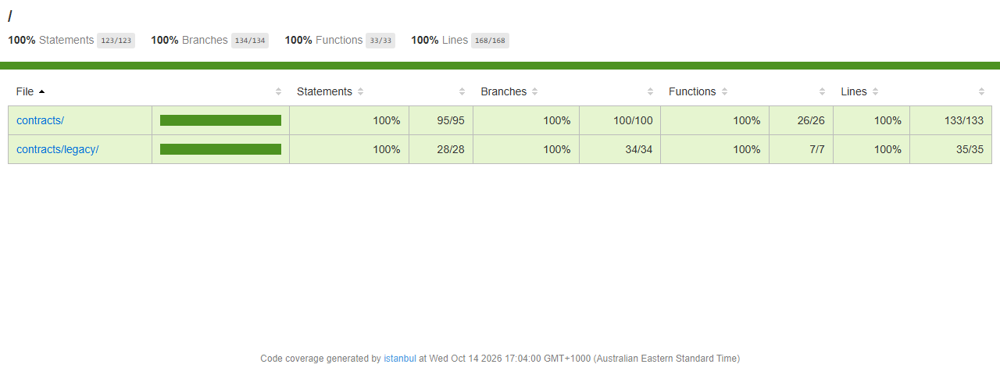
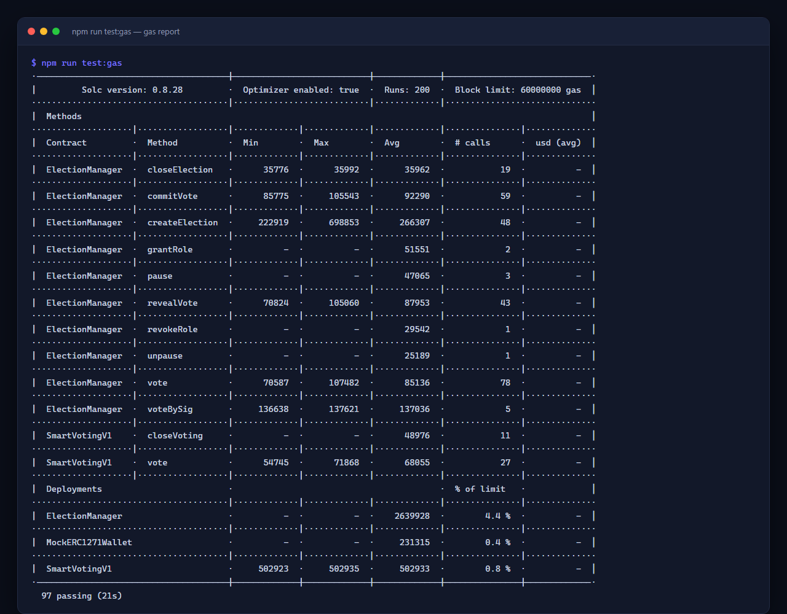
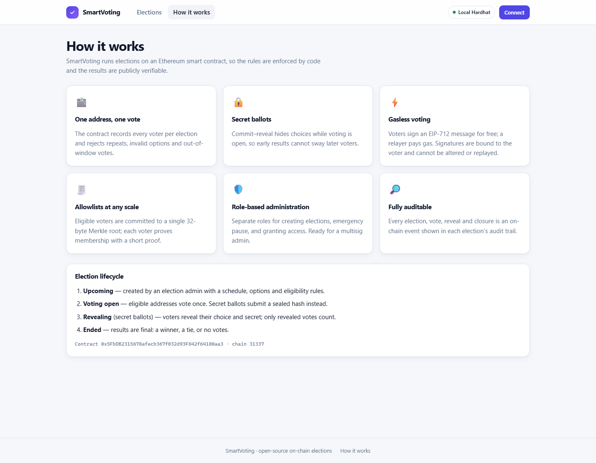
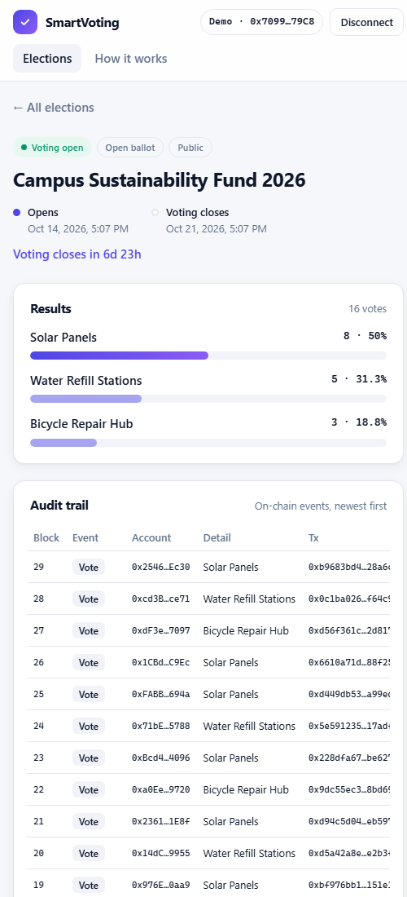

# Project journey: from coursework to platform

This page records every step taken to turn a university Remix exercise into a full-stack, tested and documented voting platform, with pictures of the result.

## Summary of steps

| #   | Step                                    | Outcome                                                                            | Status |
| --- | --------------------------------------- | ---------------------------------------------------------------------------------- | :----: |
| 1   | Review the original coursework          | Requirements and the 10 manual Remix tests extracted from the report               |   ✅   |
| 2   | Preserve v1 as a baseline               | Original contract kept in `contracts/legacy/`, logic unchanged                     |   ✅   |
| 3   | Automate the coursework tests           | All 10 report tests (plus extra tie cases) run automatically against v1            |   ✅   |
| 4   | Design the v2 platform contract         | `ElectionManager`: many elections, named options, schedules, custom errors         |   ✅   |
| 5   | Add role-based access & emergency pause | OpenZeppelin `AccessControl` (3 roles) and `Pausable`                              |   ✅   |
| 6   | Add voter allowlists                    | Merkle-root eligibility, compatible with OpenZeppelin `StandardMerkleTree`         |   ✅   |
| 7   | Add secret ballots                      | Commit–reveal with commitments bound to voter and election                         |   ✅   |
| 8   | Add gasless voting                      | EIP-712 `voteBySig` with nonces, deadlines and ERC-1271 smart-wallet support       |   ✅   |
| 9   | Write the unit test suite               | 66 tests covering every function and revert path                                   |   ✅   |
| 10  | Write randomized invariant tests        | Seeded fuzz runs checked against an off-chain reference model                      |   ✅   |
| 11  | Reach 100% coverage                     | Statements, branches, functions and lines all at 100%                              |   ✅   |
| 12  | Lint & format                           | Solhint with zero warnings, Prettier across Solidity / JS / TS / Markdown          |   ✅   |
| 13  | Build the relayer service               | Validation, rate limiting, pre-flight simulation, nonce-safe queue                 |   ✅   |
| 14  | Build the React + TypeScript dApp       | Dashboard, voting flows, secret-ballot reveal, admin console, audit trail          |   ✅   |
| 15  | Deploy & seed scripts, allowlist CLI    | One script deploys, exports the ABI to the dApp and seeds demo data                |   ✅   |
| 16  | One-command local stack                 | `npm run dev:all` starts chain, deploy, relayer and dApp                           |   ✅   |
| 17  | End-to-end testing in a real browser    | Gasless vote, secret reveal and admin creation all verified in the UI              |   ✅   |
| 18  | CI/CD pipelines                         | Lint, tests, coverage, gas report, Slither, dApp build, GitHub Pages deploy        |   ✅   |
| 19  | Documentation                           | README, architecture, threat model, security policy, contributing guide, changelog |   ✅   |
| 20  | Clean-install verification              | Full CI sequence re-run on a fresh copy: everything green                          |   ✅   |
| 21  | Testnet deployment (Sepolia)            | Scripts ready; needs your own RPC URL and testnet wallet                           |   ⏳   |
| 22  | Public hosting (GitHub Pages)           | Workflow ready; run it after step 21                                               |   ⏳   |

---

## Step 1–3: Start from the coursework

The original assignment was a single ballot for three campus sustainability proposals, tested by hand in Remix. Its 10 tests are now automated and still pass against the untouched v1 contract (see the **SmartVotingV1 (coursework baseline)** group in the test run below).

## Step 4–8: The v2 contract

`ElectionManager.sol` replaces the hard-coded three-candidate ballot with a platform: unlimited elections, 2–20 named options, scheduled windows, allowlists, secret ballots and gasless voting. Design details are in [ARCHITECTURE.md](ARCHITECTURE.md).

## Step 9–12: Testing and quality

**97 tests passing**, covering the unit suite, the randomized invariants, and the original coursework tests:

**100% coverage** on both contracts:

**Gas report** for every public function:

## Step 14: The dApp

### Dashboard

Live statistics, status filters, search, and a card for every election showing its state, ballot type and countdown.

### Voting on an open ballot

Live tallies, the voting panel with **⚡ Vote without gas**, and an on-chain audit trail of every vote.

### Secret ballot: voting phase

Tallies are hidden while voting is open; only sealed hashes appear in the audit trail.

### Secret ballot: reveal phase

After the deadline, voters reveal their choices and the counts appear.

### Allowlist enforcement

An address that is not on the election's Merkle allowlist is told it cannot vote. The contract enforces this too.

### Final results

A clear winner banner, final percentages, and the full history, including the admin's early close.

### Admin console

Create elections (with secret-ballot and allowlist options), use the emergency pause, and manage roles.

### How it works

A plain-language explanation of the guarantees for non-technical users.

### Dark mode & mobile

  
  

## Step 13, 15–17: Tooling and end-to-end checks

- `npm run dev:all` brings up the whole system in one command and seeds four demo elections, one in each state.
- In a real browser, I verified: a **gasless vote** relayed and credited to the voter (not the relayer), a **secret ballot** sealed, time-advanced and revealed, and an **election created** through the admin form.
- Bugs found and fixed during this testing: a CSS class collision in the timeline, orphaned processes on Windows when stopping the stack, and the election sort order.

## Step 18–20: CI and documentation

Every push runs formatting checks, Solhint, the tests (with 40 fuzz runs), coverage, the gas report, Slither static analysis and the dApp build. The same sequence was run on a clean install before publishing, and everything passed.

## Step 21: Public live demo

**[▶ Try it](https://amirhamzaaaa4.github.io/smart-voting-dapp/).** A blockchain demo usually needs every visitor to install a wallet and get test ETH. Instead, the demo build bundles a small EIP-1193 provider backed by `@ethereumjs/vm`. It deploys the real contract bytecode inside the visitor's browser, seeds demo elections, and signs the visitor in as a fresh voter. A **⏩ Skip 1 day** button moves chain time forward so visitors can see secret ballots reveal and elections close. It's published to GitHub Pages automatically on every push.

## Optional (step 22)

Deploy to the Sepolia testnet: add credentials to `.env`, then run `npm run deploy:sepolia`.
